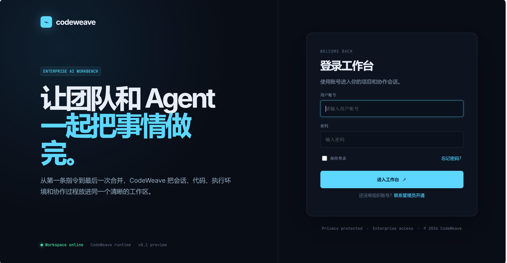
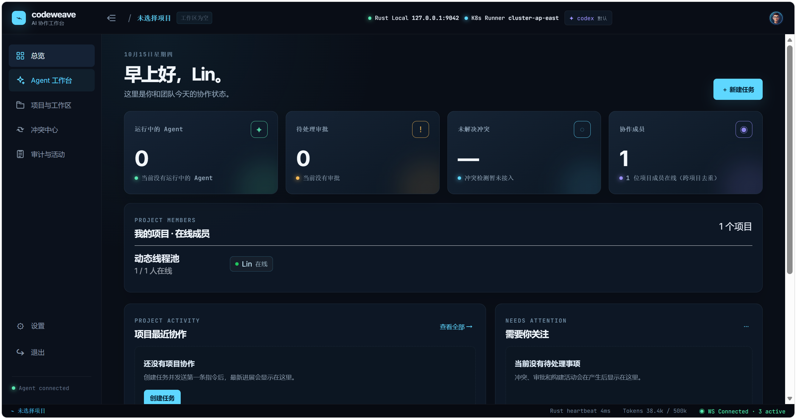
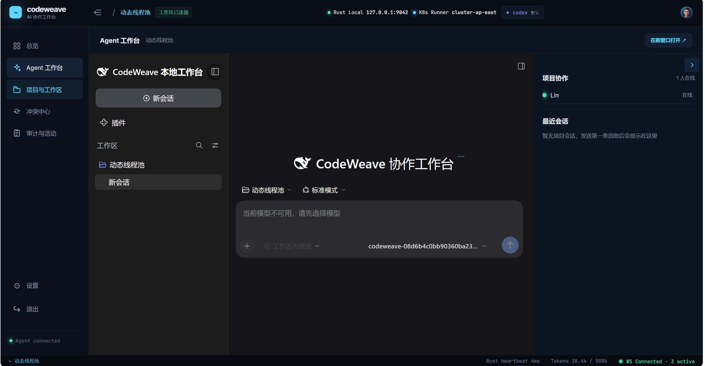
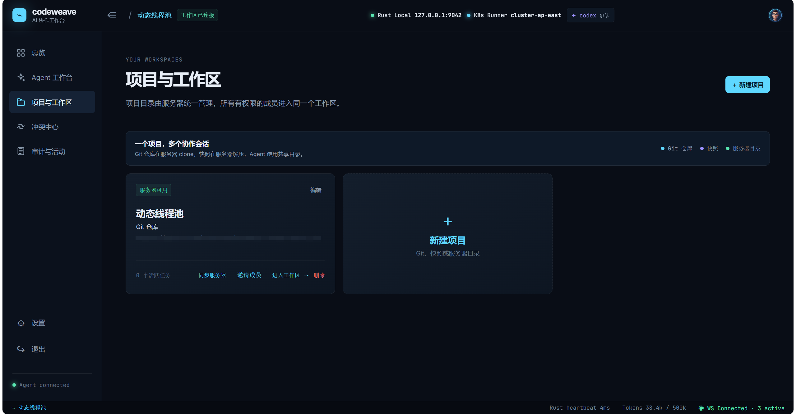
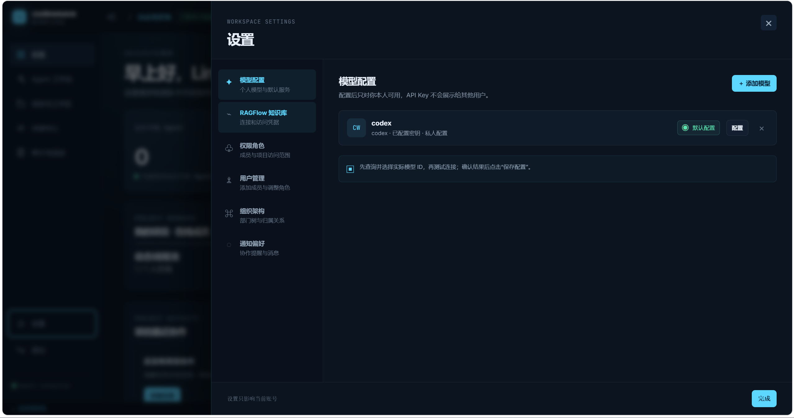

# CodeWeave

> 面向团队的 AI 编程协作工作台，让 Agent、代码工作区、审批流程与知识库真正协同起来。

[English](README.md)

CodeWeave 是一个面向研发团队的开源 AI 协作工作台。它将 AI Agent、真实项目工作区、任务执行、人工审批、团队协作、审计追踪和知识库连接起来，让 AI 从“回答问题”走向“参与真实的软件研发流程”。

## 产品截图

| 登录页面 | 总览页面 |
|---|---|
|  |  |

| Agent 工作台 | 项目与工作区 |
|---|---|
|  |  |

| 工作区设置 |
|---|
|  |

## 核心能力

- 带有项目和工作区上下文的 AI Agent 会话
- Git 仓库、快照项目和共享工作区
- 任务执行、审批流程、任务交接和冲突审查
- 团队成员、角色、项目权限和审计活动管理
- OpenAI 兼容模型配置
- RAGFlow 知识库集成
- 基于 DeepSeek Harness 的 Agent 运行能力
- React 前端与 Spring Boot 后端

## 项目结构

```text
codeweave/
├── codeweave-frontend/   # React + Vite 前端
├── codeweave-backend/    # Spring Boot 后端
└── deepseek-harness/     # 二次开发后的 DeepSeek Harness
```

## 环境要求

- Java 17+
- Maven 3.9+
- Node.js 20+ 与 npm
- Docker Desktop
- Git
- PostgreSQL、Redis、MinIO（由 Docker Compose 启动）
- 可选：RAGFlow 和 OpenAI 兼容模型服务

## 快速启动

建议按以下顺序启动：基础设施、DeepSeek Harness、后端、前端。

### 1. 启动基础设施

```powershell
cd codeweave-backend
docker compose up -d
```

这会启动 PostgreSQL、Redis 和 MinIO。

### 2. 安装并启动 DeepSeek Harness

二次开发后的 Harness 源码已经包含在本仓库中，需要 Node.js 22.19+ 和 pnpm 11.7+。

```powershell
cd ..\deepseek-harness
corepack enable
corepack prepare pnpm@11.7.0 --activate
pnpm install
pnpm run build
pnpm dsh web --no-open
```

请保持这个终端运行。Harness 默认地址是 `http://127.0.0.1:3080`。

### 3. 启动后端

```powershell
cd ..\codeweave-backend
mvn spring-boot:run
```

后端默认地址：`http://localhost:8080`

### 4. 启动前端

```powershell
cd codeweave-frontend
npm ci
npm run dev
```

前端默认地址：`http://localhost:5173`，并通过 Vite 将 `/api` 请求代理到后端。

## 配置说明

仓库中保留了用于本地开发的默认配置，方便贡献者快速启动。将系统暴露到网络或用于生产环境前，请务必修改数据库、Redis、MinIO、加密密钥、账号和模型服务配置。

不要将真实 API Key、Token、私钥或生产环境凭据提交到仓库。

## 开发与测试

```powershell
# 后端测试
cd codeweave-backend
mvn test

# 前端构建
cd ..\codeweave-frontend
npm run build
```

## 许可证

CodeWeave 使用 [MIT License](LICENSE) 发布。

`deepseek-harness` 目录包含基于原 DeepSeek Harness 项目的二次开发版本。原项目的 MIT 许可证和版权声明保留在 [`deepseek-harness/LICENSE`](deepseek-harness/LICENSE) 中。

## 项目状态

CodeWeave 仍在持续开发中，欢迎提交 Issue、功能建议、文档改进和 Pull Request。

